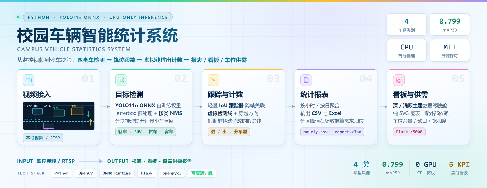
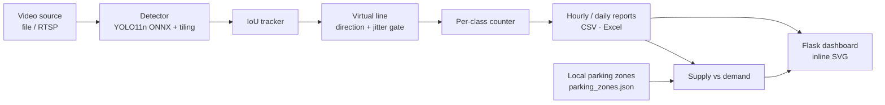

# Campus Vehicle Statistics System

[](https://github.com/shenyicong/Campus-Vehicle-Statistics-System/actions/workflows/ci.yml)
[](LICENSE)
[](CONTRIBUTING.md)

[中文文档 / Full documentation in Chinese →](README.md)

<p align="center">
  <picture>
    <source media="(prefers-color-scheme: dark)" srcset="docs/hero.png">
    
  </picture>
</p>

**From a surveillance clip to actionable traffic counts and parking supply-demand analysis.**

An end-to-end, CPU-friendly vehicle statistics pipeline: YOLO11n exported to ONNX detects four classes (sedan / SUV / truck / bus), a lightweight IoU tracker associates detections across frames, and a virtual line determines entry / exit direction. Hourly and daily reports feed a Flask dashboard drawn entirely with inline SVG — no CDN, no frontend build, no GPU required at inference time. On-site parking capacity is entered locally by the operator and compared against demand derived from traffic flow.

## Why this project

| Feature | Implementation | Without |
| --- | --- | --- |
| 4-class detection | Self-trained YOLO11n → ONNX Runtime (CPU) | PyTorch / CUDA at runtime |
| Distant small vehicles | Adaptive tiling along the longer image edge (`auto` / `grid`) | Retraining |
| Multi-object association | Minimal IoU tracker, active tracks only | ByteTrack / DeepSORT |
| Entry / exit | Virtual line + direction + minimum net displacement | Lane annotations |
| Dashboard | Flask + hand-drawn SVG, dark / light themes | Chart.js / CDN / npm |
| Parking planning | Per-class peak occupancy vs. locally configured supply | Occupancy sensors |

The business location is decoupled from the algorithm: point the camera at a campus gate, a parking entrance or an internal road — only `LINE_Y` and `parking_zones.json` change.

## Architecture



See [docs/architecture.md](docs/architecture.md) for module contracts and design decisions.

## Quickstart (60 seconds, no model needed)

```bash
python -m venv .venv
# Windows: .venv\Scripts\activate | Linux/macOS: source .venv/bin/activate
pip install -r requirements.txt

# Windows
set CAMPUS_DETECTOR=mock && python main.py --max_frames 60
# Linux / macOS
CAMPUS_DETECTOR=mock python main.py --max_frames 60

python web_dashboard.py   # http://127.0.0.1:5000
```

For real inference, place an ONNX model at `models/car_yolo.onnx` and run `python main.py --max_frames 600`. The `mock` detector exercises the entire pipeline with synthetic traffic, so you can validate the environment before wiring in a model.

## Configuration

Key fields in `config.py` (all overridable with `CAMPUS_*` environment variables):

| Field | Meaning |
| --- | --- |
| `CLASSES` | Class order; must match annotation and model output (`sedan, suv, truck, bus`) |
| `DETECTOR` | `yolo_onnx` (default) or `mock` |
| `CONF_THRES` / `IOU_THRES` | Confidence / NMS thresholds |
| `TILE_MODE` | `auto` (default), `grid`, `1`, `0` |
| `LINE_Y` | Normalized virtual line; recalibrate with `tools/calibrate_line.py` |
| `MIN_TRACK_MOVE` | Minimum net displacement to suppress jitter-induced false crossings |
| `REPORT_DIR` | Report directory shared by CLI and dashboard |
| `PARKING_ZONES_JSON` | Local parking capacity configuration |

## Model

Trained on 298 images / 311 boxes (80 / 20 split), YOLO11n, 100 epochs, imgsz 640, on AMD ROCm (W7900): **mAP50 0.799**, mAP50-95 0.569, precision 0.725, recall 0.788. Class indices `0 sedan / 1 SUV / 2 truck / 3 bus`.

> Validation metrics do not tell the whole story. The v1 training set is dominated by single large-vehicle crops (96.6% of images have one box), so multi-vehicle scenes tend to be merged into one large box and distant vehicles are missed. `tools/augment_dataset_v2.py` and `tools/regression_test.py` exist to fix the data distribution and verify with a fixed real-world regression set rather than val mAP alone. Full evaluation notes (in Chinese) are in [docs/real_video_eval.md](docs/real_video_eval.md).

## Reproduce an end-to-end count

```bash
python tools/calibrate_line.py --video "D:/path/to.mp4" --frames 240
python tools/eval_count_video.py --video "D:/path/to.mp4" --tile grid --line-y 0.65 --out data/real_eval_demo
python tools/plan_parking.py
```

## Development

```bash
pip install -r requirements-dev.txt
pytest -q
ruff check --select E9,F63,F7,F82 .
python tools/check_docs_links.py
```

CI runs on Python 3.10 / 3.11 / 3.12. See [CONTRIBUTING.md](CONTRIBUTING.md), [SECURITY.md](SECURITY.md) and [CHANGELOG.md](CHANGELOG.md).

## Documentation

- [Architecture & module contracts](docs/architecture.md)
- [FAQ](docs/FAQ.md)
- [Real-video evaluation](docs/real_video_eval.md)
- [Virtual line calibration](docs/line_calibration.md)
- [Parking planning methodology & limits](docs/parking_plan.md)

## License

[MIT](LICENSE) © 2026 shenyicong
