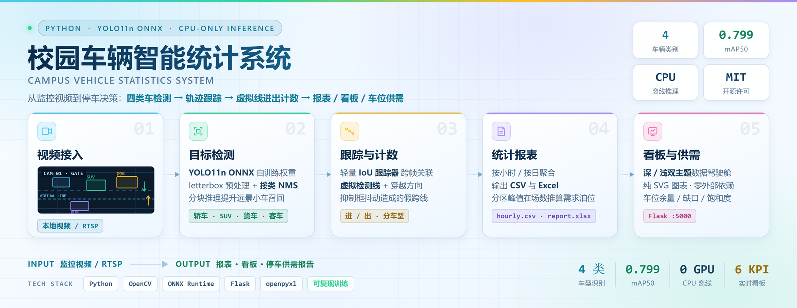
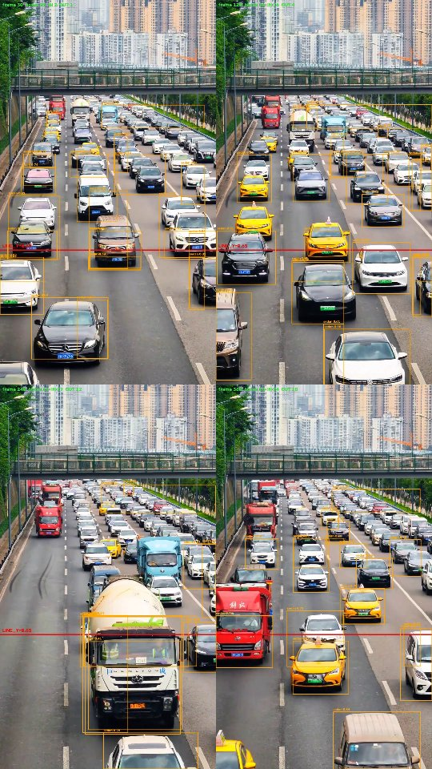
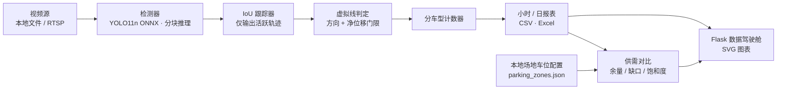

# 校园车辆智能统计系统 · Campus Vehicle Statistics System

[](https://github.com/shenyicong/Campus-Vehicle-Statistics-System/actions/workflows/ci.yml)
[](https://www.python.org/)
[](LICENSE)
[](CONTRIBUTING.md)
[](docs/architecture.md)
[](https://github.com/shenyicong/Campus-Vehicle-Statistics-System)

<p align="center">
  <picture>
    <source media="(prefers-color-scheme: dark)" srcset="docs/hero.png">
    
  </picture>
</p>

**从一段监控视频，到可决策的车流数据与停车供需结论。** 基于 YOLO11n ONNX 的四类车型检测（轿车 / SUV / 货车 / 客车）、轻量 IoU 跟踪、虚拟线进出判定，输出小时 / 日粒度报表与纯 SVG 数据驾驶舱；**场地实有车位由本地人员按现场录入**，系统再把流量推算出的泊位需求与实有车位做供需对比（余量 / 缺口 / 饱和度 / 状态）。

> 摄像机装在校门、停车场入口或园区道路都可以，算法与代码不变；换位置后用 `tools/calibrate_line.py` 重新标定虚拟线即可。本仓库以校园为业务示例，不限定具体地点。
>
> **English** → [README.en.md](README.en.md)

---

## 目录

- [亮点](#亮点)
- [演示](#演示)
- [系统架构](#系统架构)
- [60 秒跑通](#60-秒跑通)
- [安装与真实模型](#安装与真实模型)
- [项目结构](#项目结构)
- [配置说明](#配置说明)
- [模型与训练结果](#模型与训练结果)
- [真实场景评估](#真实场景评估)
- [从流量统计到停车规划](#从流量统计到停车规划)
- [云端训练流程](#云端训练流程)
- [设计取舍与已知限制](#设计取舍与已知限制)
- [路线图](#路线图)
- [贡献 · 文档 · 引用](#贡献--文档--引用)
- [许可证](#许可证)

---

## 亮点

| 能力 | 实现方式 | 不依赖 |
| --- | --- | --- |
| 四类车型检测 | 自训练 YOLO11n → ONNX，letterbox 预处理 + 按类 NMS | GPU / PyTorch 运行时 |
| 远景小车召回 | 按画面长边自适应分块推理（`auto` / `grid`） | 重新训练模型 |
| 跨帧关联 | 轻量 IoU 跟踪器，仅返回本帧活跃轨迹 | ByteTrack / DeepSORT |
| 进出判定 | 虚拟线 + 穿越方向 + 最小净位移抑制抖动 | 车道线标注 |
| 报表 | 小时 / 日 CSV 与 Excel（`utf-8-sig`，Excel 直接打开） | 数据库 |
| 数据驾驶舱 | Flask + 内联 SVG 自绘图表，深 / 浅双主题 | Chart.js / CDN / 前端构建 |
| 车位供需 | 分车型峰值在场数 → 需求泊位，与本地录入的实有车位对比 | 车位级占用传感器 |
| 可复现训练 | ROCm 云端一键脚本 + 固定回归集 A/B 验收 | 本地 GPU |

设计原则：**一条数据流贯穿到底**（视频 → 检测 → 跟踪 → 计数 → 报表 → 看板），所有环节都可在 `mock` 模式下无模型跑通；**场地与算法解耦**（换机位只改 `LINE_Y`，换场地只改 `data/parking_zones.json`）。

---

## 演示

<p align="center">
  
</p>

<p align="center"><sub>真实固定机位视频：检测框、虚拟线与进出方向</sub></p>

| 看板 / 训练 | 预览 |
| --- | --- |
| 深 / 浅双主题数据驾驶舱 | `python web_dashboard.py` → `http://127.0.0.1:5000`，或 `python tools/make_dashboard_snapshot.py` 生成离线快照 |
| 训练曲线 | [`docs/training_curves.png`](docs/training_curves.png) |
| 真实视频评估记录 | [`docs/real_video_eval.md`](docs/real_video_eval.md) |

看板包含 6 张 KPI 卡、分车型进出柱图、车型结构环图、24 小时热力、停车供需环与分区饱和度、逐时段明细；悬浮可看数值，5 秒刷新且不会打断表单编辑。图表全部由 SVG 自绘，**不依赖 Chart.js 或任何 CDN，离线可用**。

---

## 系统架构



```
视频源 → 检测器 → 跟踪器(IoU) → 进出判定 → 计数器 → 报表(CSV/Excel) → 网页看板
                                                    ├→ 需求侧：分车型峰值在场数 → 需求泊位
本地人员录入场地车位(data/parking_zones.json) ──────┴→ 供需对比：余量 / 缺口 / 饱和度 / 状态
```

各模块的契约、坐标约定与关键设计决策见 [`docs/architecture.md`](docs/architecture.md)。

---

## 60 秒跑通

不需要 GPU、不需要模型权重、不需要视频文件：

```bash
python -m venv .venv
# Windows: .venv\Scripts\activate   |   Linux/macOS: source .venv/bin/activate
pip install -r requirements.txt

# Windows
set CAMPUS_DETECTOR=mock && python main.py --max_frames 60
# Linux / macOS
CAMPUS_DETECTOR=mock python main.py --max_frames 60

python web_dashboard.py     # 打开 http://127.0.0.1:5000
```

`mock` 模式会生成模拟车流，跑通「检测 → 跟踪 → 计数 → 报表 → 看板」全链路，适合先验证环境再接入真实模型。

---

## 安装与真实模型

### 1. 准备环境

```bash
python -m venv .venv
pip install -r requirements.txt
# 关键依赖：opencv-python / numpy / onnxruntime / flask / openpyxl
```

开发 / 测试额外安装 `pip install -r requirements-dev.txt`，详见 [CONTRIBUTING.md](CONTRIBUTING.md)。

### 2. 放入模型

把训练好的 ONNX 放到 `models/car_yolo.onnx`（路径由 `config.YOLO_ONNX` 指定）。模型权重不入库。

### 3. 运行统计（默认真实模型）

```bash
python main.py --max_frames 600
```

运行后会在 `data/reports/` 生成 `hourly.csv`、`daily.csv` 与 `report.xlsx`。没有模型时切回模拟数据：

```bash
# Windows
set CAMPUS_DETECTOR=mock && python main.py --max_frames 600
# macOS / Linux
CAMPUS_DETECTOR=mock python main.py --max_frames 600
```

### 4. 启动网页看板

```bash
python web_dashboard.py
# 浏览器打开 http://127.0.0.1:5000
```

不想启动服务时，可直接生成一份数据已内联的静态快照，双击 HTML 即可预览：

```bash
python tools/make_dashboard_snapshot.py
# 输出 data/reports/dashboard_preview.html（只读；保存场地配置需启动服务）
```

### 5. 设置本场地的车位（本地人员操作）

两种方式写的是同一个文件 `data/parking_zones.json`：

1. **看板抽屉（推荐）**：打开 `http://127.0.0.1:5000` → 右上角「场地车位设置」→ 改场地名称、分区名、勾选适用车型、填写实有车位数量 → 点「保存场地配置」。支持「+ 添加分区」「删除」「放弃修改」；5 秒自动刷新不会打断正在编辑的表单。
2. **文本编辑**：直接改 `data/parking_zones.json`，或先运行 `python tools/plan_parking.py --init-zones` 生成一份模板。

仓库内的默认示例就是校园场景：

| 分区 | 适用车型 | 实有车位 |
| --- | --- | --- |
| A 区 | 轿车 / SUV | 360 |
| B 区 | 客车 / 货车 | 180 |

分区数量、名称、车型组合、车位数量都不写死；换场地可用 `set CAMPUS_PARKING_ZONES=D:/path/to/zones.json` 指向另一份配置。保存后重新运行规划即可看到供需对比：

```bash
python tools/plan_parking.py        # 输出 parking_plan.md / csv / xlsx
```

---

## 项目结构

```
campus_vehicle_system/
├── config.py                  # 全局配置（路径 / 类别 / 虚拟线 / 视频源 / 端口）
├── video_input.py             # 视频输入：本地文件 或 RTSP 实时流
├── detector.py                # Mock 检测器 + YOLO-ONNX（预处理 / 解码 / NMS / 分块）
├── tracker.py                 # 轻量 IoU 跟踪器
├── counter.py                 # 虚拟线进出判定与计数
├── reporter.py                # 每小时 / 每日 CSV 与 Excel 报表
├── parking_plan.py            # 场地车位配置读写 + 需求推导 + 供需对比
├── main.py                    # 端到端串联入口
├── make_test_video.py         # 用车型图片合成模拟校门监控测试视频
├── web_dashboard.py           # Flask 数据驾驶舱：双主题 + 纯 SVG 图表 + 场地设置
├── cloud/                     # ROCm 云端训练：上传 / 训练 / 导出 / 冒烟测试
├── tools/                     # 数据集切分、增强、回归、评估、标定、规划、上传
│   ├── augment_dataset_v2.py      # 多车同框 / 小目标 / 硬负样本合成
│   ├── regression_test.py         # 固定真实场景回归集 A/B
│   ├── upload_dataset_platform.py # Ultralytics Platform 数据集上传
│   ├── check_docs_links.py        # 文档本地链接校验（CI 使用）
│   └── ...                        # calibrate_line / eval_* / plan_parking / split_dataset
├── tests/                     # 29 项纯逻辑单元测试（tracker / counter / reporter / 配置 / 供需）
├── docs/                      # 架构、评估记录、标定、停车规划、Hero 与 Social Preview 素材
├── .github/
│   ├── workflows/ci.yml       # 3.10 / 3.11 / 3.12 矩阵：lint + 编译 + 测试 + 文档链接
│   ├── ISSUE_TEMPLATE/        # Bug / Feature 表单
│   ├── dependabot.yml         # pip 与 Actions 依赖周更
│   └── PULL_REQUEST_TEMPLATE.md
├── cloud_setup_yolo26_env.sh  # 兜底：从零重建 ROCm 训练环境
├── models/.gitkeep            # 放 car_yolo.onnx（模型文件不入库）
├── data/
│   ├── parking_zones.json     # 场地车位配置（本地人员维护，已入库的示例）
│   └── reports/               # 报表与供需分析输出（运行生成，不入库）
├── pyproject.toml             # ruff / pytest / mypy / coverage 配置
├── Makefile                   # install / lint / test / check / run / dashboard
├── requirements.txt · requirements-dev.txt
├── CONTRIBUTING.md · CODE_OF_CONDUCT.md · SECURITY.md · CHANGELOG.md · CITATION.cff
├── .editorconfig · .pre-commit-config.yaml · .gitignore · .gitattributes
└── LICENSE
```

---

## 配置说明（config.py 关键字段）

| 字段 | 说明 |
| --- | --- |
| `CLASSES` | 类别列表，顺序即模型输出类别顺序，须与标注 / 训练一致 |
| `DETECTOR` | `yolo_onnx` 真实模型（默认）/ `mock` 模拟检测；可用环境变量 `CAMPUS_DETECTOR` 覆盖 |
| `YOLO_ONNX` | ONNX 模型路径（默认 `models/car_yolo.onnx`） |
| `CONF_THRES` / `IOU_THRES` | 置信度阈值 / NMS IoU 阈值；`CONF_THRES` 可用 `CAMPUS_CONF` 覆盖 |
| `TEST_VIDEO` / `USE_RTSP` / `RTSP_URL` | 视频源：本地文件（可用 `CAMPUS_VIDEO` 覆盖）或 RTSP 实时流 |
| `TILE_MODE` / `TILE_SIZE` / `TILE_OVERLAP` | 分块推理：`auto` 按画面**长边**一维切块（竖屏切横块 / 宽幅横屏切竖块 / 近方形不切，默认）；`grid` 横纵都切 640×640 网格，远景小车召回最高但推理约 3 倍耗时；`1` 强制一维 / `0` 整图。可用 `CAMPUS_TILE` 覆盖 |
| `LINE_Y` | 进出判定虚拟线（归一化 y，0=顶 1=底）；换视频后用 `tools/calibrate_line.py` 标定，可用 `CAMPUS_LINE_Y` 覆盖 |
| `ENTER_WHEN` | 穿越方向：`down`=向下为进校 |
| `MIN_TRACK_MOVE` | 抑制框抖动假跨线的最小净位移（默认 0.03），可用 `CAMPUS_MIN_MOVE` 覆盖 |
| `REPORT_DIR` | 报表目录（默认 `data/reports/`），可用 `CAMPUS_REPORT_DIR` 指向某次真实视频评估的报表目录，看板与 `main.py` 共用 |
| `PARKING_ZONES_JSON` | 场地车位配置（默认 `data/parking_zones.json`），由本地人员维护；可用 `CAMPUS_PARKING_ZONES` 切换场地 |
| `WEB_HOST` / `WEB_PORT` | 看板监听地址 / 端口（默认 127.0.0.1:5000） |

---

## 模型与训练结果

- **数据**：298 张车图，311 个框（轿车 105 / SUV 52 / 货车 79 / 客车 75），8:2 切分为训练 238 / 验证 60
- **环境**：AMD Radeon Cloud，ROCm 7.2.1，W7900(gfx1100)，Ultralytics 8.4.203
- **配置**：YOLO11n 预训练权重，100 epoch，imgsz 640，batch 16
- **指标**：`mAP50 = 0.799`、`mAP50-95 = 0.569`、精确率 `0.725`、召回率 `0.788`
- **类别顺序**：`0 轿车 / 1 SUV / 2 货车 / 3 客车`，与 `CLASSES = sedan/suv/truck/bus` 一一对齐

> ⚠️ 这些数字对应仓库内的 v1 权重。**验证集指标高不等于真实场景好用**：v1 训练集 96.6% 是「一张图一辆大车」，导致多车同框被合并成巨框、远景小车漏检。改进方向是扩展数据分布（多车同框 / 小目标 / 硬负样本）并用固定回归集验收，而不是单纯加 epoch 或调置信度。相关工具见 `tools/augment_dataset_v2.py` 与 `tools/regression_test.py`。

---

## 真实场景评估

七段真实素材的评估数据、对比图与结论见 [`docs/real_video_eval.md`](docs/real_video_eval.md)，虚拟线标定见 [`docs/line_calibration.md`](docs/line_calibration.md)，训练曲线见 [`docs/training_curves.png`](docs/training_curves.png)。

<details>
<summary><b>展开完整实验记录（要点与数字）</b></summary>

- 夜间行车记录仪视频：框住的都是真车但漏检明显，平均置信度由同域 0.848 降到 0.535。
- 白天固定机位俯拍竖屏视频：**首因是尺度压缩**——1080×1920 整图 letterbox 到 640×640 后有效宽度只剩约 360px，远景小车缩没；分块后检出框 **125 → 623**、零检出帧 **39.3% → 0%**，无需重训。
- 火电厂街拍视频：`truck` 100 框 (0.684)、`bus` 6 框 (0.760)，整车可见时分类正确 → 前两段 `truck/bus≈0` 是画面里没有这两类车，不是模型不会认；大字水印 / 招牌从未误检。
- **分块方向修正**：`TiledYoloOnnxDetector` 改为按画面**长边**自适应（竖屏切横块、宽幅横屏切竖块、近方形不切）。1280×720 横屏密集车流检出框 **312 → 899**、零检出 **36.1% → 14.8%**；竖屏与合成横屏回归均无退化。
- **二维网格分块**：新增 `CAMPUS_TILE=grid`，横纵都切 640×640（缩放≈1）。俯拍远景 2 帧探针：整图 14 → 一维 24 → **网格 41** 框，新增框全是真车、无误检；代价约 3 倍推理时间，默认仍为 `auto`。
- **跟踪器修复**：`IoUTracker` 只返回本帧活跃轨迹，消除僵尸轨迹造成的「运动车流被误判静止」与重复计数（合成视频 进 31 / 出 10 → **进 2 / 出 2** 真值）；重庆内环视频标定每帧 36.6 → 13.4 框、`|dy|` 中位 0 → 0.0042。
- **虚拟线标定与假过车抑制**：`tools/calibrate_line.py` 发现俯拍画面车辆 cy 常全在 0.59 以上，默认 `LINE_Y=0.5` 落在空白区导致计数恒为 0；静止车流框抖动会制造假过车，`MIN_TRACK_MOVE` 抑制后安宁区视频复测 **11 进 / 9 出 → 1 进 / 0 出**。
- **端到端计数演示已完成**：重庆内环高速俯拍（1080×1920 / 12.1s）是首个满足「固定机位 + 无剪辑 + 车流持续移动」的素材。全片 363 帧 `grid` 推理：**7096 框 / 每帧 19.55 / 零检出 0% / 平均置信度 0.608**，四类车全部检出；`LINE_Y=0.65` 计数 **进 54 / 出 18**（轿车 43/14、SUV 4/1、货车 4/3、客车 3/0），hourly/daily CSV、Excel 报表与演示图均已产出。
- **限制**：远景小车仍漏检约一半；单横线用于高速双向车流只是链路演示，不是真实校门通行量真值；12 秒片段只有 1 个小时桶；计数未经人工逐帧核验。补 50–100 张俯拍远景样本微调、换 ByteTrack 与分车道双向虚拟线是后续重点。
- 工具：`eval_real_video.py`（抽样检测评估 + 框面积分档）、`calibrate_line.py`（虚拟线标定 + 静止判定）、`eval_count_video.py`（固定机位视频一次推理产出检测统计 + 计数 + 报表 + 演示图）。

</details>

一键复现（换成自己的固定机位视频，先标定再端到端）：

```bash
python tools/calibrate_line.py --video "D:/path/to.mp4" --frames 240
python tools/eval_count_video.py --video "D:/path/to.mp4" --tile grid --line-y 0.65 --out data/real_eval_demo
```

---

## 从流量统计到停车规划

系统统计的是**通过虚拟线的分车型通行流量**，不是车位级占用检测。「有多少车位」由**本地人员按现场录入**（供给侧），「需要多少车位」由流量**推算**（需求侧），两者口径不同，系统做的是**供需对比**。算法层与业务位置解耦：校门 / 停车场入口 / 园区道路共用同一套代码，换机位只需重标定 `LINE_Y`；换场地只需改 `data/parking_zones.json`。

| 决策 | 用到的数据 | 输出 |
| --- | --- | --- |
| 拥堵治理 | 每小时进出合计、高峰小时 | 疏导时段、出入口通行能力评估 |
| 车位够不够 | 场地实有车位 + 分车型峰值在场数 | 每区余量 / 缺口、峰值饱和度、状态（供给充足 / 接近饱和 / 超负荷） |
| 分区与配比规划 | 分区适用车型、需求泊位 | 小车位（轿车 / SUV）与大车位（货车 / 客车）配比、用地面积参考 |

```bash
python tools/plan_parking.py                      # 默认读 data/reports/hourly.csv 与场地配置
python tools/plan_parking.py --hourly <某次评估>/reports/hourly.csv --out-dir <输出目录>
python tools/plan_parking.py --init-zones         # 生成场地配置模板给本地人员填写
python web_dashboard.py                           # 数据驾驶舱：统计图表 + 场地设置 + 供需对比
python tools/make_dashboard_snapshot.py           # 无需启动服务的静态预览快照
```

以重庆内环高速俯拍真实视频的报表 + 校园默认场地配置为例（12.1 秒 → 1 个小时桶，仅演示链路）：

| 分区 | 适用车型 | 实有车位 | 峰值在场 | 需求泊位 | 余量 | 状态 |
| --- | --- | --- | --- | --- | --- | --- |
| A 区 | 轿车 / SUV | 360 | 32 | 39 | +321 | 供给充足 |
| B 区 | 客车 / 货车 | 180 | 4 | 5 | +175 | 供给充足 |

实有合计 540 / 需求合计 44，峰值饱和度 6.7%；需求侧参考配比仍为小车位 39 / 大车位 5（88.6% / 11.4%），用地约 941.6 ㎡，高峰小时通行 72 辆次。
⚠️ 因为样本只有 12 秒，这里会提示「车位明显富余」，**不能**据此判定车位真的多了，需连续多天、覆盖全部出入口的报表。公式、默认参数、前提与局限见 [`docs/parking_plan.md`](docs/parking_plan.md)。

---

## 云端训练流程

<details>
<summary><b>展开 ROCm 云端训练步骤与踩坑记录</b></summary>

1. **标注**：X-AnyLabeling 标注四类 → 导出 `YOLO HBB`（水平矩形框）。
   > 坑：旋转框会被 YOLO HBB 导出器静默跳过，生成空 txt（错误负样本），用 `tools/fix_rotation_labels.py` 修复。
2. **新建实例**：AMD Radeon Cloud 选 Notebook / 1 GPU / AMD OneClick Base，把新的 IP:端口写入 `~/.ssh/config`。
   > 平台到点**自动销毁并删除工作区**，训练产物必须及时下载回本地。
3. **上传**：本机运行 `bash cloud/upload_dataset.sh`（上传 `D:/car_export` 与全部云端脚本）。
4. **训练**：云端运行 `bash /workspace/tools/train_car_yolo.sh`。
5. **取回**：把 `best.onnx` 下载为 `models/car_yolo.onnx`。

关键实现说明：

- 复用镜像自带 `/opt/venv` 的 torch 2.9.1+hip（GPU 可用），**不下载 5.8 GiB 的 torch ROCm wheel**；`cloud_setup_yolo26_env.sh` 仅作兜底。
- 镜像的 torchvision 只有 CPU 版 NMS kernel，Ultralytics 验证阶段会在 CUDA 张量上调用 `torchvision.ops.nms` 并报错。`cloud/rocm_compat.py` 把 NMS 输入临时搬到 CPU、算完搬回原设备，行为与原生一致。
- 云端 `pypi.org` 很慢，安装统一走阿里云镜像。
- 导出 ONNX 时须显式指定 `format=onnx`、`opset=12`、`imgsz=640`、`simplify=false`，输出布局为 `[1, 8, 8400]`；平台默认命令尾部常带 `torchscript` / `simplify=true`，需要手动改。

</details>

---

## 设计取舍与已知限制

| 取舍 | 原因 | 代价 / 边界 |
| --- | --- | --- |
| IoU 跟踪而非 ByteTrack | 零额外依赖、CPU 可跑、逻辑可审计 | 遮挡与长时间丢失后 ID 会切换 |
| 按类 NMS | 四类车型互不抑制，保留全部类别候选 | 同一辆车可能同时保留两个类别框 → 计数重复（见路线图） |
| 单条虚拟线 | 标定简单、适配固定机位单向车流 | 双向 / 多车道需分车道线（见路线图） |
| 流量推算泊位需求 | 无需车位传感器即可给出规划依据 | 是**需求下限**，依赖「所有出入口都被统计」的前提 |
| 场地车位本地录入 | 系统不写死任何场地信息 | 配置准确性由现场人员负责 |

更完整的契约说明见 [`docs/architecture.md`](docs/architecture.md)，常见问题见 [`docs/FAQ.md`](docs/FAQ.md)。

---

## 路线图

- [x] YOLO11n ONNX CPU 推理、按类 NMS 与自适应分块
- [x] IoU 跟踪、虚拟线进出判定、小时 / 日报表
- [x] 双主题零依赖 SVG 数据驾驶舱与静态快照
- [x] 场地车位配置与供需对比
- [x] CI、单元测试、贡献规范与文档体系
- [ ] 轨迹级类别众数投票，降低单帧错分对分车型计数的影响
- [ ] 跨类 NMS，消除同一辆车被保留为两个类别的重复框
- [ ] 分车道双向虚拟线，适配双向车流
- [ ] v2 数据集（多车同框 / 小目标 / 硬负样本）重训 + 固定回归集验收

有想法？欢迎通过 [Issue 模板](https://github.com/shenyicong/Campus-Vehicle-Statistics-System/issues/new/choose) 提建议。

---

## 贡献 · 文档 · 引用

| | 链接 |
| --- | --- |
| 开发规范与 PR 流程 | [CONTRIBUTING.md](CONTRIBUTING.md) |
| 行为准则 | [CODE_OF_CONDUCT.md](CODE_OF_CONDUCT.md) |
| 安全策略 | [SECURITY.md](SECURITY.md) |
| 更新日志 | [CHANGELOG.md](CHANGELOG.md) |
| 架构与模块契约 | [docs/architecture.md](docs/architecture.md) |
| 常见问题 | [docs/FAQ.md](docs/FAQ.md) |
| 真实视频评估 | [docs/real_video_eval.md](docs/real_video_eval.md) |
| 虚拟线标定 | [docs/line_calibration.md](docs/line_calibration.md) |
| 停车规划方法与边界 | [docs/parking_plan.md](docs/parking_plan.md) |
| 英文说明 | [README.en.md](README.en.md) |

如果本项目对你有帮助，欢迎 Star ⭐；引用请使用仓库根目录的 [`CITATION.cff`](CITATION.cff)（GitHub 右上角 **Cite this repository** 可直接生成 BibTeX）。

**致谢**：[Ultralytics YOLO](https://github.com/ultralytics/ultralytics)、[OpenCV](https://opencv.org/)、[ONNX Runtime](https://onnxruntime.ai/)、[Flask](https://flask.palletsprojects.com/)、[openpyxl](https://openpyxl.readthedocs.io/)、[X-AnyLabeling](https://github.com/CVHub520/X-AnyLabeling) 与 AMD Radeon Cloud 提供的训练算力。

---

## 许可证

[MIT](LICENSE) © 2026 shenyicong
