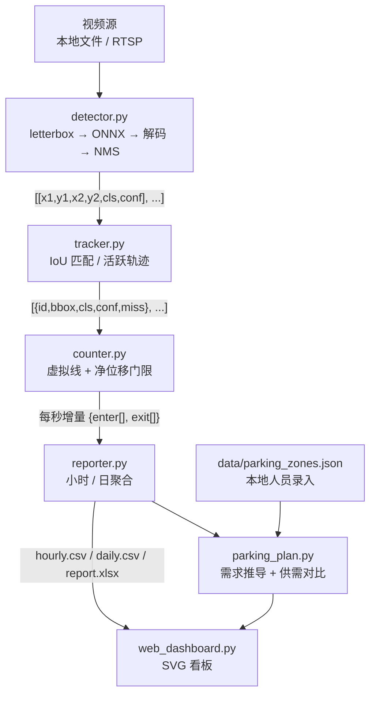

# 架构与模块契约

本文说明系统的数据流、各模块之间的输入输出约定，以及几个关键设计决策背后的原因。想快速跑起来请看 [README](../README.md)，常见问题请看 [FAQ](FAQ.md)。

## 1. 目标与边界

系统解决的是**「一段固定机位视频里，各类车进出各多少」**，并进一步把通行流量换算成停车资源规划依据。

- ✅ 做：视频/RTSP 接入、目标检测、跨帧跟踪、方向判定、分车型计数、小时/日报表、可视化看板、供需对比
- ❌ 不做：车牌识别、车型细分品牌、车位级占用检测、跨摄像头 ReID、云端托管服务
- ⚠️ 前提：所有出入口都被同一套系统统计到。只统计单个入口时净流量会持续累加，需求侧推算会高估

## 2. 数据流



入口是 `main.py`：按帧读取 → 检测 → 跟踪 → 计数 → 每满一秒把增量交给报表 → 结束时落盘 CSV 与 Excel。看板不参与推理，只读报表与场地配置，因此可以离线独立运行。

## 3. 模块契约

| 模块 | 输入 | 输出 | 关键点 |
| --- | --- | --- | --- |
| `video_input.py` | `USE_RTSP` / `RTSP_URL` / `TEST_VIDEO` | `cv2.VideoCapture` | 打开失败直接抛 `IOError`，避免静默跑空 |
| `detector.py` | BGR 帧（任意尺寸） | `[[x1, y1, x2, y2, cls_idx, conf], ...]`，像素坐标 | 输出布局 `[1, 8, 8400]`；letterbox 后需还原坐标 |
| `tracker.py` | 检测列表 | 活跃轨迹 `[{id, bbox, cls, conf, miss}]` | 只返回 `miss == 0` 的轨迹 |
| `counter.py` | 活跃轨迹 + 帧高 | 累计计数 / 增量 | 用归一化中心 y 与 `LINE_Y` 比较 |
| `reporter.py` | 时间戳 + 进出增量 | CSV / Excel | 编码 `utf-8-sig`，Excel 直接打开不乱码 |
| `parking_plan.py` | `hourly.csv` + 场地配置 | 可 JSON 序列化的供需结果 | 需求侧与供给侧口径分离 |
| `web_dashboard.py` | 报表 + 配置 | HTML / JSON | 零外部前端依赖 |

### 检测输出约定

- 类别顺序以 `config.CLASSES` 为唯一准绳：`0=轿车 / 1=SUV / 2=货车 / 3=客车`
- ONNX 输出为 `[1, 8, 8400]`：前 4 行是 `cx, cy, w, h`（640 尺度），后 4 行是四类置信度
- 预处理用 letterbox 保持长宽比，解码后需减去 padding 并除以缩放系数还原到原图
- NMS **按类别分别执行**，避免四类车型互相抑制
- `TiledYoloOnnxDetector` 按画面长边切块，各块结果映射回原图坐标后跨块合并 NMS

导出 ONNX 时应显式指定 `format=onnx`、`opset=12`、`imgsz=640`、`simplify=false`；平台默认命令尾部常带 `torchscript` / `simplify=true`，需手动改，否则 `detector.py` 无法解析输出。

### 跟踪与计数

`IoUTracker` 用贪心 IoU 匹配维护轨迹；未匹配轨迹暂留 `max_miss` 帧用于重匹配，但**不返回给下游**。否则静止旧框会被当成车辆，既虚增每帧框数，也把连续帧位移中位压成 0（曾导致「运动车流被误判静止」）。

`Counter` 判定一次跨线需要同时满足：

1. 轨迹相对参考点的净位移 `|cy - ref| >= MIN_TRACK_MOVE`（默认 0.03），压住检测框抖动造成的假过车；
2. 上一帧与当前帧的中心 y 分别位于 `LINE_Y` 两侧；
3. 穿越方向与 `ENTER_WHEN` 一致。

计数后重置参考点，避免同一轨迹反复计数。`pop_increment()` 返回自上次调用以来的增量并清零，供按时间分桶。

### 报表与看板

报表按 `(日期, 小时)` 分桶，日表由小时表聚合而来。看板提供：

| 路由 | 方法 | 说明 |
| --- | --- | --- |
| `/` | GET | 数据驾驶舱页面（内联 SVG 图表） |
| `/api/stats` | GET | KPI、分车型进出、24 小时热力等统计 JSON |
| `/api/parking_zones` | GET / POST | 读取 / 保存场地车位配置 |
| `/api/parking_plan` | GET | 供需对比结果 |

默认只监听 `127.0.0.1:5000`；需要远程访问请放在反向代理与认证之后（见 [SECURITY](../SECURITY.md)）。

## 4. 供需推导

```
某小时末在场数   = max(0, 上一小时在场数 + 该小时进入数 - 该小时驶出数)
分组峰值在场数   = 该组车辆在场数时间序列的最大值
建议泊位数       = ceil(峰值在场数 × (1 + 周转余量))       # 默认 reserve=0.20
规划用地面积     = 建议泊位数 × 单车位面积 × 通道系数       # 默认 aisle_factor=1.35
```

供给侧由本地人员录入分区名、适用车型、实有车位数；需求侧由流量推算。两者相减得到余量 / 缺口，峰值在场数与实有车位之比得到饱和度，再映射为状态（未配置车位 / 已超负荷 / 周转余量不足 / 接近饱和 / 供给充足）。`reset_daily=True` 会在跨日时把在场数归零，避免跨日累计误差。

完整公式、参数与局限见 [parking_plan.md](parking_plan.md)。

## 5. 关键设计决策与已知限制

| 决策 | 原因 | 已知代价 |
| --- | --- | --- |
| 按类 NMS | 四类车型互不抑制，召回更高 | 同一辆车可能同时保留「轿车 0.27」+「货车 0.61」两框 → 计数重复 |
| 轨迹类别取最新一帧 `dets[best_i][4]` | 实现最简单 | 单帧错分会直接计错类；应改为轨迹级类别众数投票 |
| 单条虚拟线 | 标定成本低 | 双向 / 多车道车流需分车道双向线 |
| 分块推理 | 不重训即可提升远景小车召回 | `grid` 约 3 倍推理耗时，且会产生跨 tile 重复框 |
| 场地配置本地维护 | 系统不绑定任何具体场地 | 配置准确性依赖现场人员 |

这些限制都记录在 [CHANGELOG](../CHANGELOG.md) 的 Unreleased 路线图中，欢迎贡献修复。

## 6. 质量保障

- `tests/`：29 项纯逻辑测试，覆盖 IoU、跟踪活跃轨迹、跨线方向、抖动抑制、报表聚合、配置校验与供需推导；不依赖模型、视频或网络
- `.github/workflows/ci.yml`：Python 3.10 / 3.11 / 3.12 矩阵，跑致命静态规则、全量编译、单元测试与文档链接检查
- `tools/check_docs_links.py`：校验 Markdown / HTML 中的本地链接，防止文档腐化
- `tools/regression_test.py`：固定真实场景回归集，用于每次重训后的 A/B 验收（模型效果的判据，而非 val mAP）

提交前自检：`make check`（或依次运行 `ruff check --select E9,F63,F7,F82 .`、`pytest -q`、`python tools/check_docs_links.py`）。
